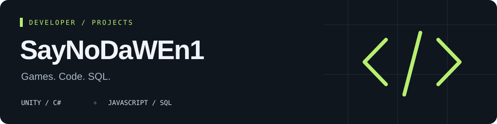

Разрабатываю игры на **Unity / C#** и веб-инструменты для изучения **SQL**.
В играх работаю с прототипами и игровыми механиками; в учебных проектах — с примерами, которые можно запустить и проверить.

### Что можно посмотреть

**[SQL на Сытом коте](https://sql-na-sytom-kote.netlify.app/)** — мой учебный портал: справочник, разборы ошибок и SQL-практика в браузере.

| Попробовать | Что внутри |
| --- | --- |
| [SQL-тренажёр](https://sql-na-sytom-kote.netlify.app/practice/) | Запросы к учебным данным и проверка результата прямо в браузере |
| [Почему JOIN удваивает сумму](https://sql-na-sytom-kote.netlify.app/knowledge/join-duplicates/) | Разбор связи «один ко многим» и ошибки в агрегатах |
| [Справочник](https://sql-na-sytom-kote.netlify.app/reference/) | Команды и примеры для повторения материала |

Сайт собран на JavaScript и Node.js. В тренажёре используется SQLite через WebAssembly (`sql.js`), выполнение запросов вынесено в Web Worker.

### Код на небольшом примере

[JOIN и агрегаты: воспроизводимый SQL-пример](examples/join-cardinality.sql) — три заказа, три позиции и четыре запроса. Показывает, откуда берётся завышенная сумма, как посчитать позиции и когда использовать `EXISTS`. Ожидаемые результаты указаны рядом с запросами; пример проверен на SQLite.

### Основные инструменты

`C#` · `Unity` · `JavaScript` · `Node.js` · `SQL` · `SQLite` · `Git`

Игровые исходники пока находятся в закрытых репозиториях. Здесь собираю публичные материалы, которые можно открыть без доступа к ним.
